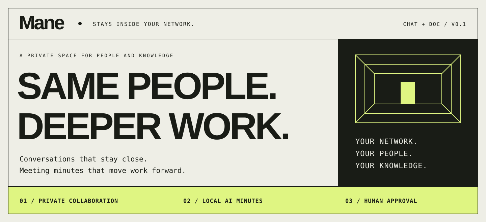
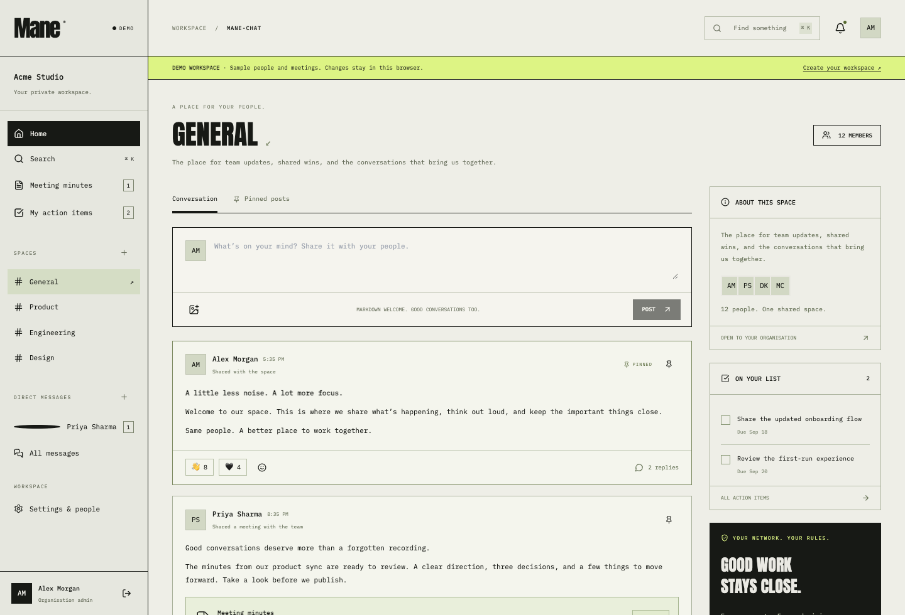
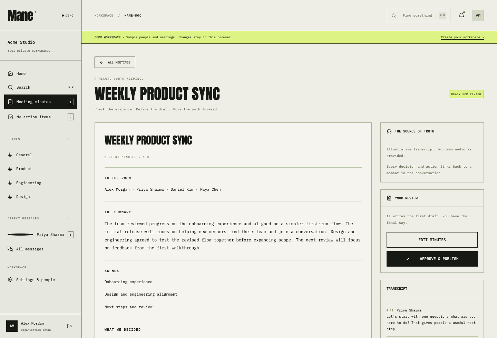
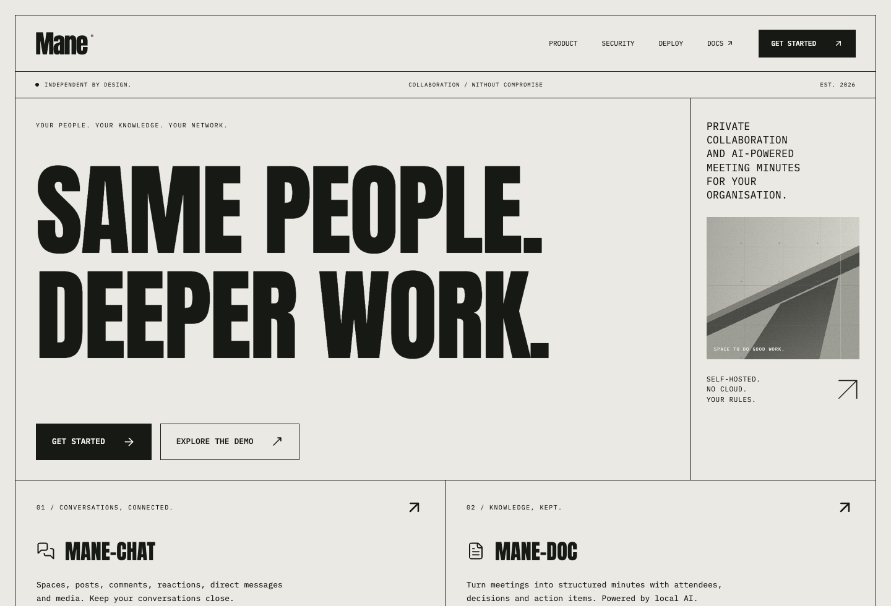
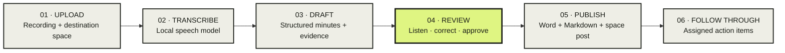
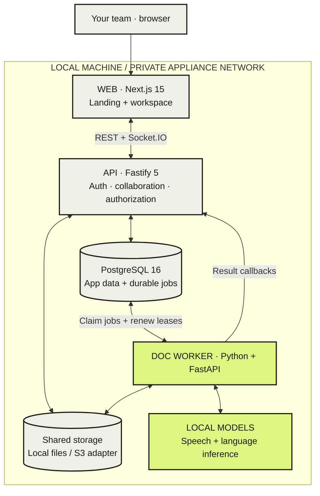

<p align="center">
  
</p>

<p align="center">
  <strong>Your conversations. Your recordings. Your infrastructure.</strong><br>
  A self-hosted workspace that brings team collaboration and reviewed meeting minutes together.
</p>

<p align="center">
  <a href="https://github.com/Nipunjaiswal442/Mane-app/actions/workflows/ci.yml"></a>
</p>

<p align="center">
  <a href="#meet-mane">Meet Mane</a> ·
  <a href="#a-look-inside">Screenshots</a> ·
  <a href="#from-recording-to-shared-knowledge">How it works</a> ·
  <a href="#run-mane-locally">Get started</a> ·
  <a href="#documentation">Documentation</a>
</p>

---

## Meet Mane

**Mane** means *stay* in Latin. It is built around a simple idea: the people you work with and the knowledge you create should have a shared home on your own network.

Discuss a project in a space. Share a recording from the meeting. Review a draft that connects decisions and actions to the source audio. Publish the finished minutes back into the conversation, with documents your team can keep.

Two modules share one organization, one login, and one admin console:

| **01 / Mane-Chat** | **02 / Mane-Doc** |
| :--- | :--- |
| **A place for the conversation.** Open and private spaces keep projects organized. Posts, comments, reactions, and pinned updates keep context together. | **A record of what matters.** Upload a meeting recording and generate a transcript plus structured minutes using models on your own hardware. |
| Direct messages, group conversations, typing indicators, read receipts, media uploads, search, and in-app notifications. | Attendees, summaries, decisions, owners, due dates, and timestamped evidence. Edit the draft, approve it, then publish Word and Markdown documents to a space. |

> **Release status — v0 development build.** The app is implemented and CI checks pass. Production acceptance is still open; [verification and known limits](#verification-and-known-limits) distinguish tested behavior from outstanding work.

## A look inside

The interface takes its cues from brutalist editorial design: oversized condensed type, hard grid lines, warm neutral surfaces, square controls, and a sharp lime accent. Fonts and artwork are bundled locally.

### The workspace

Spaces, conversations, shared context, and action items in one view.



### The review desk

Check the evidence, correct the draft, and decide what becomes the official record.



<details>
<summary><strong>See the landing page</strong></summary>

<br>



</details>

*Screenshots show the app's demo workspace with fictional sample people and illustrative minutes. Demo changes stay in the browser; they do not run inference or create backend records.*

## From recording to shared knowledge



1. **Bring the recording.** Upload M4A, MP3, WAV, WebM, or MP4 audio. Choose the space, reviewer, meeting date, and optional language hint.
2. **Keep inference local.** The worker normalizes audio, transcribes it, and extracts structured minutes. Longer transcripts are processed in overlapping chunks.
3. **Follow the evidence.** Decisions and actions carry audio timestamps. Unsupported spans are removed with confidence notes; unique verbatim quotations can have shifted timestamps corrected.
4. **Keep a person in control.** The reviewer can edit every minutes field and play evidence segments. AI output can still contain errors; approval is an explicit human step.
5. **Put the outcome to work.** Approval generates `.docx` and Markdown files, publishes a post in the destination space, and creates action items for follow-up.

## Built around your organization

| Capability | What Mane provides |
| :--- | :--- |
| **Private collaboration** | One organization per appliance, open/private spaces, scoped realtime events, and membership-aware search. |
| **Local inference** | MLX Whisper + Ollama for Apple Silicon development; faster-whisper + vLLM adapters for a Linux NVIDIA appliance. |
| **Shared administration** | Users and roles, space membership, retention settings, storage quotas, license status, hardware detection, and audit export. |
| **Access controls** | Argon2id passwords, HTTP-only sessions, CSRF checks, login rate limiting, and authorization for media and private content. |
| **Durable processing** | A PostgreSQL job queue with leases, recovery of expired jobs, and idempotent publication callbacks. |
| **Operational ownership** | Local backup/restore tools, health endpoints, structured logs, and signature verification for offline update bundles. |

Application runtime is designed to stay on the local machine or appliance network. There are no cloud AI calls, analytics, or runtime CDN fonts. Dependencies, container images, and model weights are acquired during an explicit preparation step. Production additionally needs network isolation and offline validation.

## Inside the appliance



The API owns authorization and publication. The worker owns inference and rendering. PostgreSQL coordinates jobs without Redis. The browser never calls the model service directly.

| Adapter | Mac development | Linux NVIDIA reference |
| :--- | :--- | :--- |
| File storage | Local `data/` directory | Private S3-compatible store |
| Speech | MLX Whisper · large-v3-turbo | faster-whisper · CUDA |
| Language model | Ollama · Qwen 2.5 3B | Appliance-local vLLM |
| Speaker diarization | Off | Optional pyannote with local weights |
| Authentication | Local email/password | Local or organization-local OIDC |

The NVIDIA path is implemented as adapters and a reference deployment. Exact-image validation on a GPU appliance remains outstanding. See [appliance installation](docs/appliance-install.md).

## Run Mane locally

### 1. Prepare the machine

The development target is an **Apple M4 MacBook Air, 16GB unified memory, macOS 15+**.

| Prerequisite | Preparation |
| :--- | :--- |
| Homebrew | Install before the tools below. |
| Node.js 22 LTS + pnpm 9 | Use your Node version manager, then `corepack enable`. The repository pins pnpm 9.15.9. |
| Python 3.12, uv, ffmpeg | `brew install python@3.12 uv ffmpeg` |
| OrbStack or Docker Desktop | Start the container engine. OrbStack is preferred for its smaller Mac footprint. |
| Ollama | `brew install ollama`; start the Ollama app or `ollama serve`. |

PostgreSQL is the only development container. Redis, MinIO, and LiveKit are not required for the local stack.

### 2. Clone and install

```sh
git clone https://github.com/Nipunjaiswal442/Mane-app.git
cd Mane-app
make setup
```

This installs the locked workspace dependencies and Mac worker environment, and creates a private `.env` with a random worker token. An existing `.env` is preserved. Review [`.env.example`](.env.example), especially the model paths.

### 3. Stage the local models

This is the online preparation step. Download time depends on your connection and any existing cache.

```sh
docker pull postgres:16-alpine
ollama pull qwen2.5:3b-instruct

uv run --project services/doc-worker --extra mlx --extra test \
  --with huggingface_hub python -c \
  'from huggingface_hub import snapshot_download; snapshot_download("mlx-community/whisper-large-v3-turbo", local_dir="./models/whisper-mlx")'
```

See [model preparation](docs/models.md) for alternative paths and optional speaker diarization weights. Runtime does not download missing models.

### 4. Start your workspace

```sh
make doctor
make dev
```

Open **[localhost:3000](http://localhost:3000)**, create your organization and first administrator, then add members from Settings. Keep using `localhost` to match the configured browser origin.

| Local endpoint | Purpose |
| :--- | :--- |
| [localhost:3000](http://localhost:3000) | Landing page |
| [localhost:3000/app](http://localhost:3000/app) | Team workspace |
| [localhost:3000/app?demo=1](http://localhost:3000/app?demo=1) | Browser-only demo with sample content |
| [localhost:4000/health](http://localhost:4000/health) | API and database health |
| [localhost:5000/health](http://localhost:5000/health) | Worker health and queue state |

`make dev` checks prerequisites, refreshes the static landing, starts PostgreSQL, applies migrations, and starts web/API/worker services. **Ctrl-C stops the stack while preserving the database volume.** After preparation, verify your installation with Wi-Fi disconnected.

<details>
<summary><strong>Everyday commands</strong></summary>

| Command | Purpose |
| :--- | :--- |
| `make doctor` | Check prerequisites, services, and cached models |
| `make dev` | Start the full development stack |
| `make landing` | Export the static landing to `apps/web/out/landing/` |
| `make check` | Typecheck and check formatting |
| `make test` | Run workspace, worker, network-guard, and backup safety tests |
| `make test-operations` | Run an isolated real PostgreSQL backup/restore drill |
| `pnpm build` | Build the production web app |
| `pnpm test:e2e` | Run Playwright browser acceptance |
| `make db:migrate` | Apply database migrations |
| `make db:reset CONFIRM=delete-local-data` | Explicitly delete and recreate the development database volume |
| `pnpm license:issue` | Issue a development license |

For API integration tests, create a separate disposable `mane_test` database and set `DATABASE_TEST_URL`. Never point tests at real application data. Install the browser once with `pnpm exec playwright install chromium` before running Playwright. The browser harness starts its own app services, so stop `make dev` first.

</details>

## Verification and known limits

**Verified on the initial implementation, 14 October 2026:**

| Check | Recorded result |
| :--- | :--- |
| Local automated suite | **83 passed, zero skipped**, including real PostgreSQL integration |
| Browser acceptance | **2 passed** — responsive/demo behavior and setup → realtime post → upload → review → publish |
| Build and lifecycle | Typecheck, formatting, production build, static export, full-stack health, and shutdown checked |
| Recovery | Ten application tables and audio/Markdown/DOCX bytes restored exactly in an isolated drill |
| GitHub Actions | Initial Linux / Node 22 run [passed](https://github.com/Nipunjaiswal442/Mane-app/actions/runs/38593824360) |
| Real local models | A **26.18-second synthetic clip** completed the direct transcription/draft/render smoke in **42.260 seconds** on the focused-fix rerun |

The browser publication test uses deterministic model fixtures and the actual renderer. The short live-model smoke excludes upload, queue, human review, and publication time. Neither establishes the 20-minute processing target.

**Before production:** representative minutes-quality review, the 20-minute benchmark, real-inference kill/restart recovery, whole-stack memory and load measurements, physical offline validation, and Linux NVIDIA image checks remain open. The live smoke still invented a next-meeting time and produced an inaccurate attendee uncertainty note; human correction remains necessary. Offline update signatures are verified, while update application is a v0 stub.

The [acceptance ledger](docs/acceptance.md) and [benchmark report](docs/benchmarks.md) record the evidence and remaining gates. No production certification or guaranteed processing time is claimed.

## Find your way around

```text
Mane-app/
├── apps/
│   ├── web/                  Landing, workspace, review, and admin UI
│   └── api/                  Auth, chat, media, meetings, and PostgreSQL
├── services/doc-worker/      Local inference, job processing, document rendering
├── packages/
│   ├── product-config/       Shared product copy, pricing, tiers, and flags
│   ├── shared/               TypeScript types and minutes validation schema
│   └── license/              Ed25519 verification and development issuer
├── infra/                    Compose, container recipes, and Caddy
├── scripts/                  Startup, preflight, recovery, and update verification
├── tests/e2e/                Browser acceptance flows
└── docs/                     Architecture, operations, models, and evidence
```

Private `.env` files, `data/`, model weights, and generated outputs stay out of Git. Landing content, pricing, hardware tiers, and feature flags share [one product configuration](packages/product-config/product.config.ts).

## Documentation

| Start here | Go deeper |
| :--- | :--- |
| [Implementation plan](docs/plan.md) — architecture and delivery gates | [Appliance installation](docs/appliance-install.md) — Linux/NVIDIA staging |
| [Model preparation](docs/models.md) — local weights and adapters | [Operations](docs/operations.md) — retention, backup, and recovery |
| [Acceptance ledger](docs/acceptance.md) — what has actually passed | [Offline updates](docs/updates.md) — bundle format and verification |
| [Benchmark report](docs/benchmarks.md) — timings and quality findings | [Worker guide](services/doc-worker/README.md) — pipeline internals |

---

<p align="center">
  <strong>SAME PEOPLE. DEEPER WORK.</strong><br>
  <sub>Mane · Your network. Your people. Your knowledge.</sub>
</p>
